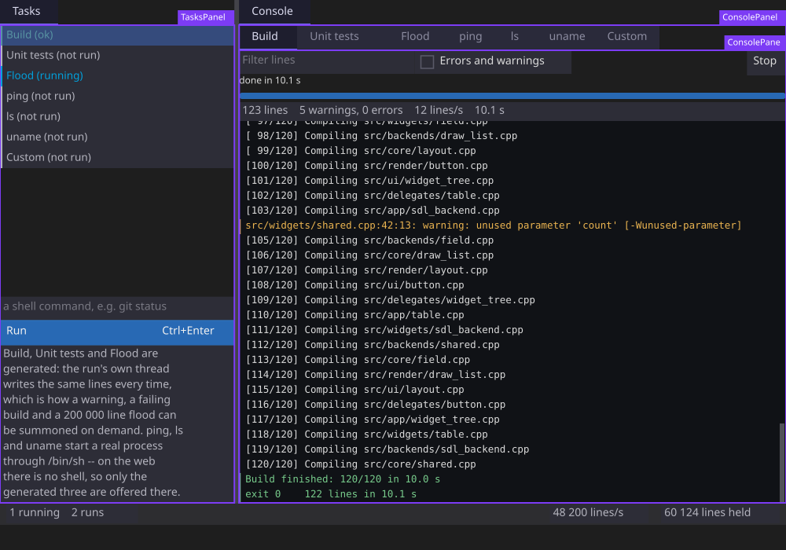
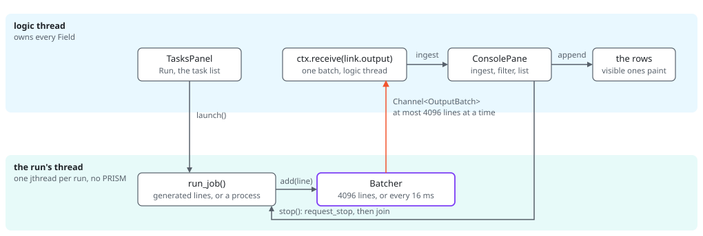

# Task Runner

An IDE-style build console: a task list on the left, one tabbed console per task on the right, and
progress, throughput and exit codes read out of the output as it arrives. Each run owns its own
thread and hands its lines to the model in batches.

<p align="center"></p>

It shows three things:

- **Blocks.** Three panels, each a struct with its fields and its view. The app only puts them
  together, and wires the three that have something to say to each other.
- **A thread per run.** A run is a `std::jthread` that sends batches of lines through one
  `core::Channel<OutputBatch>`; `ctx.receive` hands them to the logic thread.
- **Rows that are values.** A console line is a plain struct with its own `Widget<T>`, kept in a
  `core::List` that paints only the rows on screen — so a 200,000-line flood costs the same per
  frame as a twelve-line build.

The same window with each block outlined and named: every panel is one small struct, placed with
`vb.block()`.

<p align="center"></p>

## Running the example

- **In the browser:** open the [live demo](https://jeandet.github.io/PRISM/model_task_runner.html).
  There is no shell there, so only the three generated tasks are offered.
- **On the desktop:** `ninja -C builddir examples/model_task_runner/model_task_runner`, then run
  `builddir/examples/model_task_runner/model_task_runner`. **ping**, **ls** and **uname** start a
  real process through `/bin/sh`; the generated tasks, and the Custom box, work everywhere.
- **The screenshot:** pass a path — `model_task_runner out.svg` — and it seeds a finished build and
  a flood in progress with no thread and no window, then writes that file.

## How it fits together

<p align="center"></p>

Two threads per run, and only one of them touches the model:

1. Pressing **Run** (or Ctrl+Enter) asks the task list which task is selected. The app looks up its
   command, and whether this build can run it at all — a browser has no shell.
2. `ConsolePane::launch` stops whatever that console was running, empties its list, and starts a
   `std::jthread` on `run_job`, giving it a sink to send batches to.
3. On its own thread, `run_job` reads the generated script line by line, or cuts a child process's
   pipe into lines. Everything it gets goes into a `Batcher`, which flushes after 4,096 lines or
   16 ms.
4. Every flush is one `OutputBatch` sent through the one `core::Channel<OutputBatch>` the app owns.
   Its waker is `ctx.waker()`, so a batch arriving wakes the logic thread and `ctx.receive` hands it
   over there.
5. The app calls `consoles.pane(batch.task).ingest(batch)`. The console's own filter decides what it
   keeps, the kept lines are appended to a `core::List<ConsoleLine>`, and a batch from a run that has
   since been replaced is dropped by its run number.
6. The list paints the rows on screen only. If it was showing its bottom it follows the new last
   row. **Stop** sets the thread's stop token, and the join is what kills the process.

## Walkthrough

Read the files in this order. The PRISM part is `model_task_runner.cpp` and `blocks/`, 673 lines.
`process/` (1,121 lines) is plain C++: a byte stream cut into lines, a progress parser, a log that
counts what it says, the run and its thread, the generated compiler, the child process.

### A row is a value

`blocks/console_rows.hpp` is the whole of what a custom widget is here: a value type with its own
`Widget<T>` specialization. No base class, no vtable, nothing to construct and keep.

```cpp
namespace prism::ui {
template <>
struct Widget<runner::ConsoleLine> {
    static constexpr FocusPolicy focus_policy = FocusPolicy::none;
    static constexpr Height widget_h{console_rows::kConsoleRowHeight};

    static void record(DrawList& dl, const Field<runner::ConsoleLine>& field, WidgetNode& node) {
        const auto& line = field.get();
        const auto& theme = node_theme(node);
        const auto colour = console_rows::line_colour(theme, line.kind);
        ...
        dl.text(line.text,
                delegate_detail::make_point(X{console_rows::kPad},
                                            Y{(widget_h.raw() - console_rows::kConsoleGlyph) * 0.5f}),
                console_rows::kConsoleGlyph, colour, 0.f, TextAnchor::TopLeft, FontRole::Mono);
    }

    static void handle_input(Field<runner::ConsoleLine>&, const InputEvent&, WidgetNode&) {}
};
```

The fixed height is a contract: a virtual list has to know a row's height before it paints it, so
rows are measured from what `record` draws. The task list's row is a second specialization in the
same file, with its own height, its own colour and its own stripe.

### A batch is the crossing

`process/run_job.hpp` has no PRISM in it. It reads output and hands it to a `BatchSink`, and the only
thing it can say to the model is an `OutputBatch`:

```cpp
struct OutputBatch {
    std::size_t task = 0;
    unsigned run = 0;
    std::vector<std::string> lines{};
    bool finished = false;
    int exit_code = 0;
    bool stopped = false;
};
```

`run` is the launch number, and it is the reason a stopped run's last delivery cannot land in the
console that replaced it. The two constants above it set how often a batch leaves:

```cpp
void flush_if_due() {
    if (held_.empty()) return;
    if (held_.size() < kBatchLines && steady::now() - last_send_ < kBatchInterval) return;
    send_(batch(false, 0, false));
    last_send_ = steady::now();
}
```

4,096 lines bounds how big a flood's batch gets; 16 ms bounds how late a quiet run's line can be.
One crossing per batch is what lets the console keep up with 200,000 lines.

### What the model does with one batch

`ingest` runs on the logic thread, once per batch, and it is the only place a batch becomes state:

```cpp
bool ingest(const OutputBatch& batch) {
    auto kept = run.ingest(batch, filter_now());
    if (!kept) return false;
    keep(std::move(*kept));
    sync_bar();
    sync_stats();
    return true;
}
```

`run.ingest` returns nothing when the batch belongs to a replaced launch
(`if (batch.run != status_.launches) return std::nullopt;`). Otherwise the batch's lines go into the
log, the log's filter decides which of them the console shows, and the counters, the progress bar
and the stats line are recomputed from the log. `ConsoleRun` owns the log, the stopwatch and the
thread; the pane owns the widgets and reads it.

### A list that follows its tail

```cpp
p.list(rows).follow_tail();   // Widget<ConsoleLine>: a row's look is a specialization
```

That one call is what makes it a console rather than a list. When rows are appended while the list
shows its last row, the next layout moves it to the new bottom. Scrolling up means the list is no
longer at the bottom, so it stops following; scrolling back to the bottom resumes it. The model
never touches a scroll offset.

Filtering hands the list a whole new set of lines instead of appending:

```cpp
void refilter() {
    rows.replace_all(run.log().visible(filter_now()));
    sync_stats();
}
```

`replace_all` walks the old and the new set together and touches only the rows that differ, so the
list keeps the widgets it had and a filter edit does not rebuild anything.

→ skipped: a bulk append on `List<T>`, which would make the flood's cost proportional to publishes
instead of lines; add when a console has to hold millions of lines.

### main()

```cpp
int main(int argc, char* argv[]) {
    TaskRunnerApp app;

    if (argc >= 2) {
        app.seed_demo_data();
        return showcase(argc, argv, app, 1000, 700);
    }

    app::run(app, {.title = "PRISM Task Runner", .width = 1000, .height = 700,
                   .settings = &app.settings, .organization = "prism", .name = "task-runner"},
             [&app](app::AppContext& ctx) {
        ctx.receive(app.link.output, [&app](const runner::OutputBatch& batch) { app.ingest(batch); });

        ctx.clock().add([&app](auto) {
            app.on_frame();
            return true;
        });

        // The window opens with a build already running: nothing it does blocks the frame that
        // shows it starting.
        app.launch(runner::kBuildTask);
    });

    return 0;
}
```

The lambda is where the threads meet the model: `ctx.receive` is the only way a batch gets in, the
clock is what makes a run's elapsed time tick while nothing else changes, and the launch happens
after the first frame is already on its way. `app::run` opens the window, loads `settings` and saves
it on every change.

## Try this

1. Press **Run** (or Ctrl+Enter) with **Build** selected: the console follows the compile as it
   goes, the progress bar climbs from the `[ 12/120]` lines themselves, warnings turn amber, and
   the run ends with an exit code — its own, not the task's guess at one.
2. Select **Flood** and Run: 200,000 lines arrive in a second or so. Scroll up while it runs and the
   console stops following; scroll back to the bottom and it picks the run up again.
3. Type `ui/` in the filter box, or tick **Errors and warnings**: the console re-filters, and only
   the rows that differ are touched. Then start **ping** and **ls** at the same time and watch both
   tabs fill.
4. Press **Stop** while a real task runs: the process gets `SIGTERM`, then `SIGKILL`, and its exit
   code shows up as a number above 128, which is what a shell reports for a signal.

## Files

| File | What it is |
|---|---|
| `model_task_runner.cpp` | The app: composes the panels, launches runs, ingests batches, `main()`. |
| `blocks/tasks_panel.hpp` | The task list, the Custom command box, Run. |
| `blocks/console_panel.hpp` | One tab per task, one `ConsolePane` behind each, and the totals. |
| `blocks/console_pane.hpp` | One console: the filter, Stop, the progress bar, the lines. |
| `blocks/console_rows.hpp` | The two row types and how they are painted. |
| `blocks/status_bar.hpp` | Runs going, lines per second, lines held. |
| `process/run_job.hpp` | A run's thread: the generated script or the process, batched. |
| `process/console_run.hpp` | A console's log, its stopwatch and its thread. |
| `process/catalog.hpp` | The seven tasks, and which of them this build offers. |
| `process/simulation.hpp` | The build, the tests and the flood, as functions of a seed and a line index. |
| `process/child_process.hpp` | `posix_spawnp`, one non-blocking pipe, `poll`, `SIGTERM` then `SIGKILL`. |
| `process/text.hpp`, `lines.hpp`, `progress.hpp` | Bytes to lines across chunks and without ANSI; errors, warnings and the filter; `[ 42%]` and `[3/120]`. |
| `process/console_log.hpp`, `run_status.hpp` | What a run said, how long it has been going, and the captions the widgets show. |
| `process/clock.hpp`, `platform.hpp` | The steady clock, and whether this build can start a process. |
| `diagrams/run_threads.svg` | The picture above. |

`tests/test_task_runner.cpp` tests `process/` directly: chunk boundaries, ANSI, both shapes of
progress tag, the line kinds and the filter, and that a generated run is the same every time. No
window, no thread. The Python counterpart is `python/examples/17_task_runner.py`.
