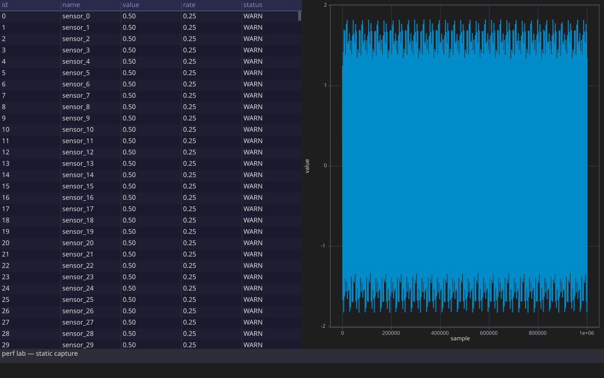
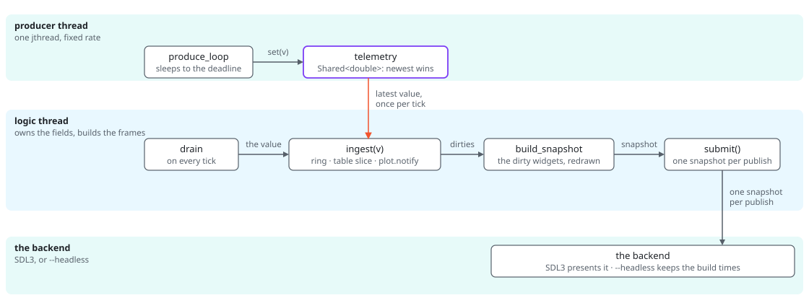

# Perf Lab

The performance laboratory: a 100k-row table, a 1M-point plot and 1 kHz telemetry in one window. A
thread pushes samples into a `Shared<double>`; the logic thread keeps the table and the plot live
from them, and prints what each frame cost to build.

<p align="center"></p>

It shows three things:

- **Cross-thread state that drops data on purpose.** The producer replaces a value; the logic thread
  takes the newest one per tick and never sees a queue.
- **Widgets that stay cheap under load.** Only the rows on screen exist as widgets — they are
  recycled from a pool as you scroll — and the million points are one polyline re-recorded when the
  data changes.
- **The frame as measured data.** Build time, dirty widget count, draw commands and snapshot bytes
  come from the snapshot itself, on screen and in the `--headless` report.

## Running the example

- **In the browser:** open the [live demo](https://jeandet.github.io/PRISM/perf_lab.html): the same
  workloads, built for the web.
- **On the desktop:** `ninja -C builddir examples/perf_lab/perf_lab`, then
  `builddir/examples/perf_lab/perf_lab`.
- **Flags:** `--rows N` (default 100 000), `--points N` (default 1 000 000), `--rate HZ` (default
  1000), and `--headless SECONDS`, which prints a report instead of opening a window. A positional
  `something.svg` captures one frame, and only as the sole argument.

## How it fits together

<p align="center"></p>

Three lanes, one value crossing between the first two:

1. `produce_loop` runs on its own thread. It makes a sample for the time since start, calls
   `telemetry.set(v)`, then sleeps until the next deadline — computed from the start, so a late tick
   is caught up rather than added as drift.
2. `Shared<double>` keeps only the newest value. `set()` marks it pending and wakes the logic
   thread; calls made before the next drain replace the value instead of queueing.
3. The logic thread drains it on every loop turn — the perpetual animation tick guarantees a turn
   per frame even with no input — and `ingest()` pushes it into the ring buffer, mutates a 1000-row
   slice of the table and marks the plot changed.
4. The next publish redraws only the dirty widgets and builds one snapshot, which carries its build
   time, dirty count, command count and size.
5. That snapshot goes to the backend: SDL3 presents it, or `--headless` counts the publish and keeps
   the build time for the report.

## Walkthrough

Read the files in this order. `main.cpp` (194 lines) is the app, the producer and `main()`;
`lab_model.hpp` (237 lines) is the workload and the arithmetic, with no PRISM in it, and
`headless_lab_backend.hpp` (76 lines) is the backend behind `--headless`.

### The model is the workload

```cpp
struct PerfLab {
    core::Shared<double> telemetry{};

    perf_lab::RingBuffer ring;
    perf_lab::LabTable table;
    plot::PlotModel plot;
    core::Field<std::string> stats_line{"warming up"};
```

Nothing exotic: two containers of your own, a plot model and one field of text. The tree asks the
model for a frame through `view()`, and `drain()` is the hook where cross-thread values arrive:

```cpp
    void drain() { telemetry.drain_notifications(); }

    void ingest(double v) {
        ring.push(v);
        table.update_slice((tick_count * 997) % table.row_count(), 1000, v);
        ++tick_count;
        plot.notify();
    }
```

### One value crosses the threads

```cpp
static void produce_loop(std::stop_token st, core::Shared<double>& out, double rate_hz) {
    perf_lab::TelemetryGenerator gen;
    const auto t0 = std::chrono::steady_clock::now();
    const auto period = std::chrono::duration_cast<std::chrono::steady_clock::duration>(
        std::chrono::duration<double>(1.0 / rate_hz));
    for (uint64_t n = 1; !st.stop_requested(); ++n) {
        const double t =
            std::chrono::duration<double>(std::chrono::steady_clock::now() - t0).count();
        out.set(gen.next(t));
        std::this_thread::sleep_until(perf_lab::tick_deadline(t0, period, n));
    }
}
```

`tick_deadline` works from `t0` and the tick number, so a slow tick is followed by a short sleep
rather than a growing delay. `Shared::set` costs one store and a flag: extra samples are dropped
here, deliberately, because a value that is already stale is not worth a queue entry.

### The series is added once

```cpp
        plot.add_series(perf_lab::RingPlotSource{&ring}, plot::SeriesStyle{});
```

The ring buffer is the series store: `RingPlotSource` reads it at record time, so a million points
cost no copy. `ingest()` only bumps `plot`'s revision, and the canvas in `view()` depends on it:

```cpp
                vb.canvas(plot)
                    .depends_on(plot.x_range)
                    .depends_on(plot.y_range)
                    ...
                    .depends_on(plot.revision);
```

That list is the repaint contract: zooming re-records, new data re-records, and a frame where none
of those changed draws the canvas straight from the last recording.

### The stats line comes from the snapshot

```cpp
        if (auto* entry = ctx.registry().find(ctx.window().id()); entry && entry->current_snap) {
            const auto& s = *entry->current_snap;
            const double age_ms =
                std::chrono::duration<double, std::milli>(now - s.built_at).count();
            scene = fmt::format("build {:.1f}ms · dirty {} · cmds {} · {} · age {:.0f}ms",
                                s.build_time_ms, s.dirty_widget_count, s.draw_command_count,
                                perf_lab::format_bytes(s.approx_bytes), age_ms);
        }
```

`SceneSnapshot` is the frame the backend draws, and it records what it cost to build. The numbers
come from the same object the renderer was handed, not from a counter kept alongside — the FPS and
present time above come from `present_stats()`, which only a presenting backend has.

### A backend that only counts

```cpp
    void submit(prism::app::WindowId,
                std::shared_ptr<const prism::render::SceneSnapshot> snap) override {
        std::lock_guard lk(m_);
        ++publish_count_;
        build_times_.push_back(snap->build_time_ms);
        last_ = {snap->dirty_widget_count, snap->draw_command_count, snap->approx_bytes};
    }
```

That is a whole backend. `run()` waits on a condition variable until the deadline and then delivers
`WindowClose`, so the app runs its normal loop with nothing drawing. It prints publishes per second
and the min, median, p95 and max build time, which is the number to watch when changing the publish
path.

### main()

```cpp
    auto cfg = perf_lab::parse_lab_args({argv + 1, argv + argc});
    PerfLab app(cfg->rows, cfg->points);
    ...
    app::model_app({.title = "PRISM Perf Lab", .width = 1280, .height = 800}, app,
                     [&](app::AppContext& ctx) {
        app.telemetry.observe([&app](const double& v) { app.ingest(v); });
        ctx.clock().add([&app, &ctx](ui::AnimationClock::time_point now) {
            app.update_stats(ctx, now);
            return true; // perpetual — also what keeps Shared<T> draining with zero input
        });
        producer = std::jthread(produce_loop, std::ref(app.telemetry), cfg->rate_hz);
    });
```

The setup callback is the only place with threads in it: the clock callback returns `true`, so the
tick never stops, and the producer is a `std::jthread` that lives in `main`, so it stops and joins
when `main` returns. `--headless` builds the same model and the same snapshots with a backend that
never draws, which is what makes the two reports comparable.

## Try this

1. Run it and read the bottom line: FPS, present time, then build time, dirty widgets, draw commands
   and snapshot size, with the snapshot's age.
2. `--headless 10`: the same workloads with no presents at all; the report gives publishes per second
   and build-time min, median, p95 and max.
3. `--headless 10 --points 5000 --rows 1000` against that one: the p95 falls with the ring and the
   table, leaving what the frame pipeline itself costs.
4. `--rate 0.5`: one sample every two seconds reaches the logic thread, so the plot crawls. The
   1 kHz default is the same thing from the other side: a thousand `set()`s a second, drained once
   per frame, so most of them are replaced before anyone reads them.

## Files

| File | What it is |
| --- | --- |
| `main.cpp` | The app: the workload model, the producer thread, the stats line, `main()`. |
| `lab_model.hpp` | Ring buffer, column table, telemetry generator, argument parsing, statistics. |
| `headless_lab_backend.hpp` | The `--headless` backend: waits out the deadline, keeps each publish's build time. |
| `meson.build` | The target, the SVG capture, the thread pool flag for the web build. |
| `diagrams/frame.svg` | The picture above. |

`tests/test_perf_lab.cpp` tests `lab_model.hpp` with no window and no thread: the ring buffer's
order, the table's wrapping slice, the parser's defaults and errors, the drift-free deadline and the
percentiles.
