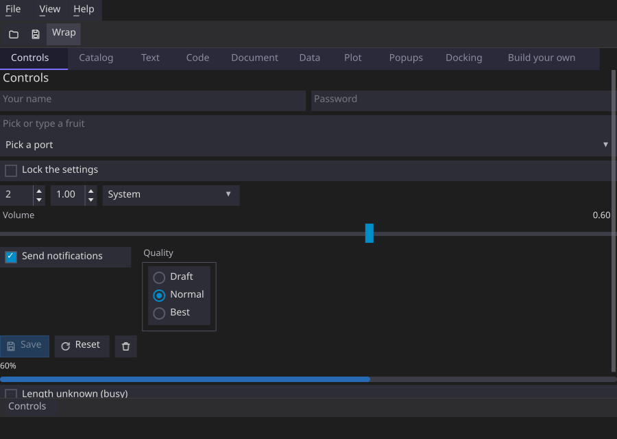
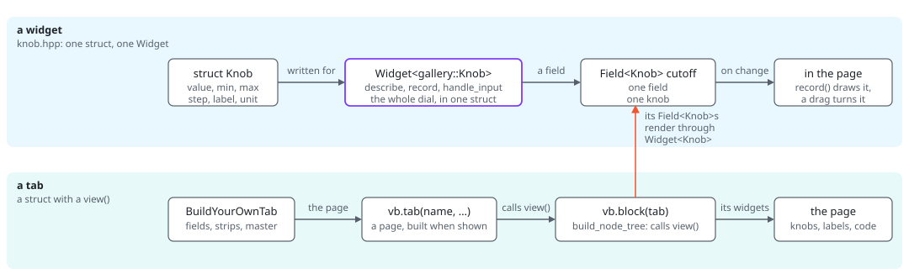

# Widget Gallery

Every PRISM widget in one window: nine tabs under a menu bar, from text fields and a date picker to
a 10 000-row table and a dockable layout. Each tab is a plain struct of fields, and this app only
arranges them. It is where you try a widget, then read the line of C++ that makes it.

<p align="center"></p>

It shows three things:

- **A widget is a value type and one specialization.** `knob.hpp` builds a rotary control from
  nothing: a `Knob` struct, its geometry as free functions, and one `Widget<Knob>` that draws it and
  handles its input.
- **A tab is a struct and a block.** A tab holds fields and a `view()`; `vb.block()` turns that
  struct into the page's widgets. There is no base class to inherit and nothing to register.
- **The catalog is data.** One `Entry` per widget holds its name, its documentation, its code line,
  and a function that places a live sample of it.

## Running the example

- **In the browser:** open the [live demo](https://jeandet.github.io/PRISM/widget_gallery.html) — the
  same tabs, compiled to WebAssembly.
- **On the desktop:** `ninja -C builddir examples/widget_gallery/widget_gallery`, then
  `builddir/examples/widget_gallery/widget_gallery`.
- **A capture:** `builddir/examples/widget_gallery/widget_gallery out.svg [tab number]` renders one
  tab (0 for Controls, 7 for Build your own) and writes it as SVG.

## How it fits together

<p align="center"></p>

Two mechanisms, one file each, and a tab's knobs tying them together:

1. `Knob` is a plain struct: a value, a range, a step, a label, a unit. It knows nothing about
   drawing, and the geometry lives in free functions beside it.
2. `Widget<gallery::Knob>` is the only thing that knows what a knob looks like: `describe()` reports
   it as a slider with a range, `record()` draws the dial, `handle_input()` turns it.
3. A `Field<Knob>` therefore is a control: the tree finds that specialization, calls `record()` to
   draw it and `handle_input()` when it is clicked or focused. No registration, no factory.
4. A tab is a struct with fields and a `view()`; `main.cpp` gives each one a page with
   `vb.tab(name, …)` and places the struct with `t.block(tab)`.
5. `block()` asks the tree for a node tree of the struct, which calls the struct's `view()` — so the
   fields it holds become the page's widgets, in the order `view()` places them.

## Walkthrough

Read the files in this order. The PRISM part is `knob.hpp` (163 lines) and
`build_your_own_tab.hpp` + `.cpp` (118 and 64), with `main.cpp` (124 lines) arranging the rest. The
nine tabs are a header and a `.cpp` each, about 1 250 lines together: one tab's `view()` compiles in
its own file, so editing a tab recompiles one file.

### A value type with no drawing in it

```cpp
struct Knob {
    double value{};
    double min{0.0};
    double max{1.0};
    double step{};         // 0 = continuous
    std::string label{};   // under the dial, with the value under that
    std::string unit{};
    bool operator==(const Knob&) const = default;
};
```

Everything about where the hand sits is a free function over that value, so it can be tested with no
window anywhere near it:

```cpp
inline double turned(const Knob& k, core::DX dx, core::DY dy) {
    if (std::hypot(dx.raw(), dy.raw()) < dead_centre) return k.value;
    const double deg = std::atan2(dy.raw(), dx.raw()) * 180.0 / std::numbers::pi;
    const double past_min = std::fmod(deg - from_deg + 720.0, 360.0);
    const double f = past_min <= sweep_deg ? past_min / sweep_deg : fraction(k) >= 0.5 ? 1.0 : 0.0;
    return snapped(k, k.min + f * (k.max - k.min));
}
```

The dial turns 270 degrees from min to max, and the gap at the bottom holds whichever end is nearer:
dragging past the maximum does not wrap back to the minimum.

### One specialization draws it

```cpp
        dl.filled_rect(delegate_detail::make_rect(X{0}, Y{0}, w, extent),
                       Color::rgba(0, 0, 0, 0));
        dl.circle(centre, body_radius, t.surface_active);
        dl.circle(centre, body_radius, t.border, 1.f);
        dl.polyline(kd::arc(centre, dial_radius, from, kd::angle_at(1.0)), t.track_hover,
                    track_thickness);
        dl.polyline(kd::arc(centre, dial_radius, from, to), accent, track_thickness + 1.f);
        dl.line(kd::point_at(centre, body_radius * 0.4f, to),
                kd::point_at(centre, body_radius - 1.f, to), accent, 2.f);
```

Nothing here is a widget or an object with state: `record()` appends to a `DrawList` and returns. The
first line is a transparent rectangle, drawn only so layout has a fixed size to give a leaf — the
knob is 72 by 76 whatever the window does.

### The same specialization takes the input

```cpp
    static bool turn(Field<gallery::Knob>& f, const InputEvent& ev, const WidgetNode& node) {
        if (const auto* mm = std::get_if<MouseMove>(&ev); mm && node_vs(node).pressed) {
            const X middle{std::max(size.raw(), node_allocated(node).w.raw()) / 2.f};
            return assign(f, gallery::knob_detail::turned(f.get(), mm->position.x - middle,
                                                          mm->position.y - dial_y));
        }
        if (const auto* kp = std::get_if<KeyPress>(&ev)) return nudge(f, *kp);
        return false;
    }
```

A press only grabs the knob, so a click that focuses it never changes the value; the hand is where
the pointer is, measured from the dial's centre. `assign()` writes the field only when the value
actually changes, and returning `true` from `turn()` is what marks the widget dirty for repaint.

### A tab is a struct and a block

```cpp
struct BuildYourOwnTab {
    using Vb = app::ViewBuilder;
    ...
    core::Field<Knob> cutoff{{.value = 2400.0, .min = 100.0, .max = 12000.0, .step = 10.0,
                              .label = "Cutoff", .unit = "Hz"}};
    std::array<ChannelStrip, 8> strips{};
    core::Field<Knob> master{{.value = -3.0, .min = -60.0, .max = 6.0, .step = 0.5,
                              .label = "Master", .unit = "dB"}};
```

Those fields are the tab; `main.cpp` gives it a page and places it:

```cpp
        vb.tabs(tabs, [&] {
            vb.tab(tab_names[0], [&](app::ViewBuilder& t) { t.scroll([&] { t.block(controls); }); });
            ...
            vb.tab(tab_names[7], [&](app::ViewBuilder& t) { t.scroll([&] { t.block(build_your_own); }); });
        });
```

`vb.tab` records a name and the content builder, and runs that builder each time the page is shown,
after clearing the previous page's widgets: nine tabs cost one tab's widgets. `vb.block(tab)` hands
the struct to the tree, which calls its `view()` — the same call any hand-written widget code makes,
one level up the tree.

### The catalog is data

```cpp
        E{"Slider", "Inputs", "A value in a range: drag, click, or the arrows. A label shows the value.",
          "core::Field<ui::Slider<>> volume{{.value = 30, .max = 100, .step = 1, .label = \"Volume\", .unit = \"%\"}};",
          one(s.slider)},
```

An entry is a name, a category, a sentence, a line of code and a function that places a live field.
The tab builds one page per entry from the same list, so the documentation, the snippet and the
sample cannot drift apart:

```cpp
void CatalogTab::page_view(Vb& vb, std::size_t i) {
    vb.widget(text[i].name);
    vb.widget(text[i].doc);
    if (!entries[i].code.empty()) vb.widget(text[i].code);
    if (!entries[i].sample) return;
    vb.gap(12.f);
    vb.widget(text[i].try_it);
    vb.gap(4.f);
    entries[i].sample(vb);
}
```

Adding a widget to the catalog is adding one `Entry` — no list of pages to keep in step.

### main()

```cpp
    // .settings: the preferences come back at the next start, window size included.
    core::Connection theme_link;   // follows the Theme dropdown; ends with run()
    app::run(app, {.title = "PRISM Widget Gallery", .width = 1000, .height = 700,
                   .settings = &app.prefs, .organization = "prism", .name = "widget-gallery"},
             [&app, &theme_link](app::AppContext& ctx) {
        app.popups.ctx = &ctx;
        ctx.on_file_drop([&app](const input::FileDrop& drop) { app.popups.dropped(drop); });
        auto apply = [&ctx](gallery::Theme t) {
            if (t == gallery::Theme::System) ctx.follow_system_theme();
            else ctx.set_theme(t == gallery::Theme::Light ? ui::light_theme() : ui::dark_theme());
        };
        ...
```

The Setup callback is where a model learns about the platform: the file dialogs' context, the
drop target, the theme. The theme connection is kept outside so it can be closed after `run`
returns — the callback's `ctx` does not outlive it, and neither may the connection.

## Try this

The tabs, in the order they appear:

| Tab | What to try in it |
| --- | --- |
| Controls | Every input widget, live: type, pick, drag, tick. The Lock toggle greys the group below it, and the Save button waits for a name. |
| Catalog | Pick a widget on the left; its documentation, its code line and a live sample are on the right. |
| Text | Selection, clipboard, undo across a code sample and prose; Hebrew and Arabic run right to left, and combining marks stay attached. |
| Document | Type Markdown on the left; the right side renders it as you type: headings, lists, quotes, code, tables. The rendering is a `text::Document` in `vb.text_view`, which lays out only what is in sight. |
| Data | 10 000 rows, seven columns, sorted by clicking a header; drag a header to move that column, drag its edge to resize it, right-click the header to hide columns. |
| Plot | Two sliders and a checkbox refill the plot's two series; beside them a hand-drawn Lissajous canvas reads the ratio field. |
| Popups | Dialogs, a popover, a context menu and the platform's file dialogs, each opened by a button. |
| Docking | Four panels in a dock. Drag a panel's tab onto another panel: the guide puts it in that panel's tabs, beside it, or along a side; let it go outside the window to float it. The arrangement is a preference. |
| Build your own | Three knobs from `knob.hpp`, the file itself, then eight `ChannelStrip`s and a master. Drag a knob; the meter under it follows. |

Alt+F, Alt+V and Alt+H open the menus, and View switches tabs.

## Files

| File | What it is |
| --- | --- |
| `main.cpp` | The window: menus, toolbar, the nine tabs, settings, `main()`. |
| `knob.hpp` | The rotary control: a `Knob` value type, its geometry, one `Widget<Knob>`. |
| `build_your_own_tab.*` | The tab that shows the knob file, then eight `ChannelStrip` blocks. |
| `catalog_tab.*` | The catalog: one `Entry` per widget, and the page built from it. |
| `controls_tab.*` | Text, number, choice and date widgets, plus the derived-value wiring. |
| `text_tab.*` | Text rendering: code, prose, right-to-left, read-only. |
| `data_tab.*` | The 10 000-row table, its columns and a list. |
| `plot_tab.*` | The plot, refilled from two sliders and a checkbox, and a hand-drawn canvas. |
| `popups_tab.*` | Dialogs, popovers, context menus, file dialogs, drops. |
| `docking_tab.*` | A dock layout, and the widgets around it. |
| `gallery_icons.hpp` | Loads the toolbar icons, marked symbolic so they follow the text colour. |
| `icons/` | The SVG icons the toolbar and the catalog use. |
| `meson.build` | The target, one translation unit per tab, the icon path, the SVG capture. |
| `diagrams/anatomy.svg` | The picture above. |

`tests/test_knob.cpp` includes `knob.hpp` and tests it with no window: the snapping, the 270 degrees,
the bottom gap holding the nearer end, the drag, the arrow keys, and the `record()` output.
